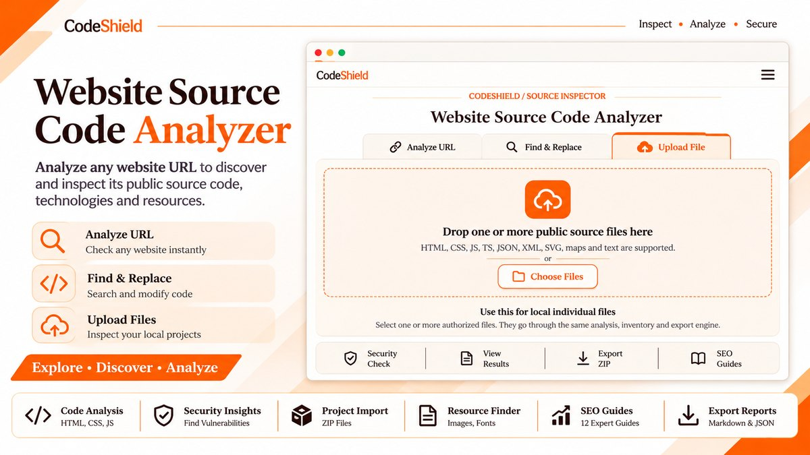

# CodeShield v22

<div align="center">
  
  <h1>CodeShield v22</h1>
  <p><strong>Website Source Code Analyzer &amp; Security Scanner</strong></p>
  <p>Inspect authorized public web assets, understand what a site ships to the browser, and present actionable security review signals in a polished product experience.</p>

  <p>
    <a href="https://codbyshareef.blogspot.com"></a>
    <a href="https://codbyshareef.gumroad.com/l/jqnnif"></a>
    <a href="https://github.com/CodByShareef/codeshield"></a>
  </p>
</div>

<p align="center">
  
</p>

> **Public showcase notice** — This repository is a presentation-focused edition of CodeShield. It keeps the interface, visual system, documentation, guides and example assets, but intentionally excludes the commercial analyzer engine, crawler, backend/API implementation, proprietary scanning rules, project workspace engine and buyer package.

## Product overview

CodeShield is designed for developers, website owners and authorized reviewers who need a clear view of the public source code delivered by a website. The product presentation focuses on a simple workflow: provide an authorized public URL or local project, review source and security signals, then export useful documentation.

This repository serves two purposes:

1. **Developer portfolio:** a curated example of product design, static-site structure, technical writing and security-aware presentation.
2. **Official product showcase:** a visual introduction to the commercial CodeShield product and its client-facing capabilities.

The home page in this public repository runs a local showcase demo only. It does not fetch URLs, process uploaded files, contact an API or expose the commercial implementation.

## Product capabilities

The attached product presentation describes the following commercial CodeShield capabilities. They are documented here as product highlights; the underlying commercial implementation is intentionally not published in this repository.

| Capability | What it communicates |
|---|---|
| **Analyze URL** | Discover public HTML, CSS, JavaScript and related assets from an authorized website. |
| **Security findings** | Group review signals by High, Medium and Low severity with clear next steps. |
| **Find & Replace** | Search an imported project, edit files, replace text or remove files in a local workspace. |
| **Upload File** | Review individual source files or ZIP projects in the browser. |
| **Export reports** | Present project files and review results as ZIP, Markdown or JSON exports. |
| **SEO guide library** | Include practical security and source-code guides that support product discoverability. |
| **Responsive presentation** | Deliver a clean experience across phones, tablets and desktop screens. |
| **Safety-first controls** | Emphasize authorized use, bounded analysis and responsible disclosure. |

## Showcase highlights

- **Portfolio-ready product identity** with a distinctive CodeShield visual language.
- **Client-facing information architecture** covering product value, safety, requirements, rights and FAQ content.
- **Static showcase interface** with a local sample-result flow that does not expose proprietary functionality.
- **Documentation library** covering frontend security, public-resource discovery, source maps, headers and exposed-key review.
- **SEO-ready static pages** with canonical placeholders, sitemap, robots directives and social preview artwork.
- **Security-conscious presentation** with responsible-use messaging, restrictive headers and no credentials or private configuration.

## Technology stack

### Public showcase edition


- Semantic HTML pages with responsive CSS.
- Vanilla JavaScript for the local showcase interaction and navigation behavior.
- Static image assets in PNG, JPEG and WebP formats.
- Plain documentation and guide pages with no build dependency.
- GitHub-friendly relative image links and static-site organization.

The commercial product page references deployment options such as Netlify, Vercel and Node hosting. Deployment is intentionally outside the scope of this repository and no deployment configuration or backend source has been restored here.

## Repository structure

```text
.
├── .gitignore
├── LICENSE
├── README.md
└── public/
    ├── _headers
    ├── index.html
    ├── robots.txt
    ├── sitemap.xml
    ├── assets/
    │   ├── css/site.css
    │   └── img/
    │       ├── logo.png
    │       ├── preview.jpg
    │       └── CodByShareef profile images
    ├── guides/          # 12 security and source-code guides
    └── pages/           # About, Contact, Help, Privacy, Terms and more
```

## Visual preview

The repository includes the product preview used throughout the showcase:

<p align="center">
  
</p>

The developer profile artwork is retained in `public/assets/img/` for the public developer page and portfolio context.

## Product links

<p align="center">
  <a href="https://codbyshareef.blogspot.com"><strong>Visit the Main Website</strong></a>
  &nbsp;&nbsp;•&nbsp;&nbsp;
  <a href="https://codbyshareef.gumroad.com/l/jqnnif"><strong>View the Official Gumroad Product</strong></a>
</p>

- **Main Website:** [codbyshareef.blogspot.com](https://codbyshareef.blogspot.com)
- **Official Product:** [codbyshareef.gumroad.com/l/jqnnif](https://codbyshareef.gumroad.com/l/jqnnif)
- **Developer:** [CodByShareef](https://github.com/CodByShareef)
- **Contact:** [codebyshareef@gmail.com](mailto:codebyshareef@gmail.com)

## Security and scope boundary

The public repository does **not** contain:

- Commercial backend or API source code.
- URL crawling, redirect validation or private-address protection logic.
- Proprietary static-analysis rules or detection algorithms.
- ZIP parsing, project indexing, editing or export implementation.
- Buyer package, original source archive, credentials, private keys or environment files.

The showcase is intended for product presentation and portfolio review. Use the commercial product only on websites, source code and files you own or are explicitly authorized to inspect.

## Local preview

Because this showcase is static, you can preview it with any simple HTTP server:

```bash
python3 -m http.server 8000 --directory public
```

Then open <http://127.0.0.1:8000> in a browser. The home-page action renders sample results locally; it does not perform a live scan.

## License

The included material remains proprietary. See [`LICENSE`](LICENSE). No commercial implementation, deployment permission or resale right is granted by this public showcase repository.

<div align="center">
  <sub>Designed and presented by <a href="https://codbyshareef.blogspot.com">CodByShareef</a> · CodeShield v22</sub>
</div>
